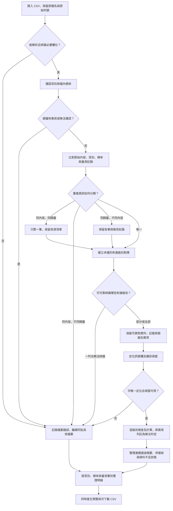

# OAE CSV 批次驗證、判定與匯出規格

本文件定義 `/v2/` 的批次驗證。逐列計算沿用 Python 的轉換常數、雜訊統計及判定公式。摘要沿用 [SPEC.md](SPEC.md) 的連續通過規則，並定義資料無法判定時的處理方式。

## 1. 規格依據

本機測試的 10 份私有 CSV 涵蓋左右耳各 5 個頻率。每份有 7 列，同一檔案內的 `AudFreq()` 一致，並與檔名頻率相符。同頻率的左右耳檔案有相同的 `F1/F2/F3` 與訊號欄號。這組資料的 `Level()` 均為 0，`Rec No.` 在各檔案內連續遞增，`V1(dBv)` 隨記錄順序下降。整批有記錄編號缺口。

交換整批匯入順序後，現行計算結果相同。交換單一檔案前兩列後，結果改變。按 `Rec No.` 排回後，結果與原檔相同。現行程式也接受與檔內頻率不符的介面標籤，並會為完全相同的檔案產生重複輸出。

這些觀察用於建立檢查規則。設備的刺激級別對應、記錄編號適用範圍及雜訊視窗跨邊界政策，仍須由量測流程確認。

## 2. 整體流程

此流程先建立各筆檔案的歸屬，再處理重複。最後逐檔定位訊號欄並逐列判定。尚待確認的檔案可在畫面修正後重新計算。下載仍可包含其他已完成的結果與這些檔案的問題紀錄。

## 3. 匯入、歸屬與批次核對

| 判斷 | 處理 | 目的與防止的情境 |
| --- | --- | --- |
| CSV 結構可解析 | 保存原始檔名、原始列號，以及每檔穩定的來源識別。驗證必要欄位可唯一辨識。若整份檔案無法解析，記錄檔案錯誤。若能辨識個別異常列，將問題限制在該列。 | 讓重新排序後的錯誤仍能定位到原檔，避免一份壞檔使整批中止。 |
| 耳別是否已確認 | 以使用者已確認的左右耳分組為準。檔名只用於初次帶入與提示差異。耳別未確認時，該檔暫不列入耳別摘要。 | 避免檔名誤植將結果放進錯耳。 |
| `AudFreq()` 是否一致 | 將 Hz 與介面 kHz 轉成同一單位再比較。欄位通過有限正數檢查且 7 列一致時，以檔內值為預設。若有缺值或互相矛盾，記錄問題，待確認歸屬及哪些列屬於該頻率。 | 避免把 32000 Hz 的資料當成 31 kHz，或將多個頻率的列混成一個摘要。 |
| 檔名或介面頻率是否與檔內值衝突 | 同時顯示原始值與介面值。接受檔內值即可解除衝突。若使用者明確覆寫，保留原始值、確認值及覆寫紀錄。檔名可作為人工確認的線索。 | 避免無聲改標籤，並保留可查的資料來源。 |
| 哪些檔案可比較 | 先確認量測批次與匯出設定，再比較表頭、頻譜欄序、同頻率的 `F1/F2/F3` 和訊號欄號。遇到差異時提示設定或格式不一致。若本檔仍可獨立驗證，可保留本檔結果。 | 避免拿不同設備設定或不同次量測互相補值。左右耳同頻率可以比較欄位設定，各自保留量測值。 |

## 4. 重複資訊的優先順序

先檢查原始內容是否完全相同，再比較使用者確認的耳別與頻率。不同次量測分開匯入。

| 情況 | 判斷與處理 | 目的與防止的情境 |
| --- | --- | --- |
| 完全相同的內容，同耳同頻率 | 同一量測批次內只算一次，列出所有匯入來源。檔名不同也要檢查內容。 | 避免從不同資料夾匯入同一份檔案後重複計數。 |
| 完全相同的內容，不同耳別或頻率 | 標記歸屬衝突。使用者確認前，不將這份內容同時計入兩個正式摘要。CSV 保留各來源和衝突原因。 | 避免把同一份量測當成左右耳各一份，或當成兩個頻率。 |
| 內容不同，同耳同頻率 | 各筆獨立計算並保留可識別的明細。保留各筆摘要並記錄同耳同頻率有多筆。 | 避免匯入先後、檔名或通過列數決定保留哪一次量測。 |
| 同一量測中 `Rec No.` 重複 | 核對兩份資料是否為同一原始記錄。相同內容依重複處理。內容不同則標出記錄衝突，保留原始來源待確認。不同量測批次的編號各自解讀。 | 避免記錄編號重用時誤刪資料，也避免同一記錄被無聲覆蓋。 |

## 5. 刺激級別與訊號欄定位

| 判斷 | 處理 | 目的與防止的情境 |
| --- | --- | --- |
| 有可信的刺激級別欄位 | 直接核對預期級別、缺漏與重複，再依級別由高到低排列。 | 即使原始 CSV 列順序改變，也能維持同一個級別對應。 |
| 只有 `Rec No.` 可判斷順序 | 對已確認的固定匯出格式，檢查編號為整數、唯一且符合預期序列，按編號排序，再依已確認的量測流程套用 `85_75` 到 `25_15`。用 `V1` 下降趨勢複核。若 `V1` 缺值，只記錄該項複核無法完成。若趨勢矛盾且無其他可信資訊，提示複核級別。 | 防止把列位置或振幅大小當成刺激級別的唯一依據。不同檔案之間缺少部分編號只作提示。 |
| 只確認部分級別 | 可靠對應的列繼續計算。未確認的級別標記為無法判定。只有在可證明該檔的起始編號和級別對應時，才把檔內缺號對應到特定級別。 | 避免某列缺漏後，將所有後續列錯標成上一個級別。 |
| 訊號欄能否唯一定位 | 優先採用已驗證的欄位標識，並用本檔有效的 `V3` 核對。若無標識，依本檔有效 `V3` 比對頻譜序列，只採用唯一匹配。若需參考同設定檔案的欄號，把它作為候選，再用本檔資料確認。沒有可核對的有效列，或候選仍有歧義時，記錄定位錯誤。 | 避免單列 `NaN` 使其他有效列一律失效，也避免隨意選到同值的其他頻譜欄。 |
| 雜訊視窗是否可建立 | 移除訊號欄，按已確認的欄序建立 Python 相容視窗。正常視窗有 20 欄。空視窗或不足欄數且無已確認的邊界規則時，標記為無法判定。 | 避免取到訊號、選錯頻譜區段，或把空視窗的運算結果當成真正的未通過。 |

## 6. 有效值、逐列判定與摘要

每個已確認級別依序檢查該列的 `V3` 與實際選入雜訊視窗的值。這些值與轉換後的訊號、NF、NF_SD、判定線都必須有限。係數沿用使用者設定，且必須有限並大於或等於零。若係數無效，暫停全批數值判定，提示修正，仍可下載問題紀錄。視窗外的數值可忽略，除非程式正用該欄確認歸屬、順序或訊號位置。計算所需的值缺漏時，保留該列的錯誤並繼續下一列。本規格暫採完整視窗，若量測流程允許排除部分雜訊值，再另定最少有效欄數與對應驗收案例。

有效列沿用 Python 的轉換常數及公式。訊號大於 `NF + 係數 × NF_SD` 為 `pass`，其餘有效數值結果為 `fail`。缺值、無限值或計算異常為「無法判定」。這三種狀態均保留在明細。

| 從最高刺激音量往下的結果 | 摘要門檻與 NF | 目的與防止的情境 |
| --- | --- | --- |
| 7 列均為有效 `fail` | `75+`、`NA`。 | 記錄七個已測級別均未通過。 |
| 第一列 `fail`，後續至少一列 `pass` | `75+`、`NA`，標記「待複核」。其餘無法判定的列另記原因。 | 依最高音量優先的判讀方式輸出摘要，並在明細保留較低音量的通過結果。 |
| 第一列 `fail`，後續沒有已知 `pass`，但至少一列無法判定 | `75+`、`NA`，並記錄無法判定的列。 | 最高音量的已知失敗已確定摘要，較低音量的資料問題另行記錄。 |
| 第一列 `pass`，連續通過後遇到已知 `fail`，且中間沒有無法判定的列 | 連續通過 1 至 6 列分別輸出 `75、65、55、45、35、25`，NF 取最後一列連續通過列。已知 `fail` 之後的各列仍照常算。 | 讓門檻與 NF 來自同一級別。後段缺值不影響已確立的終點。 |
| 7 列全為 `pass` | `15`，NF 取第 7 列。 | 記錄已測到的最低通過級別。 |
| 第一列無法判定，或連續 `pass` 之後先遇到無法判定 | `NA`、`NA`，標記「資料不足」。後續各列繼續計算。 | 保留確定的明細，避免把未知當成通過或失敗。 |

例如，`85_75 = pass`、`75_65 = 無法判定`、`65_55 = fail` 時，`65_55` 的失敗可以確定，摘要仍可能是 `75` 或 `65`。若前兩列改為 `pass → fail`，第三列即使無法判定，摘要仍是 `75`。兩例都要繼續處理更低的刺激音量。

## 7. 預覽、匯出與驗收

預覽與下載使用同一次計算的結果。依耳別、頻率及可識別的量測筆別分組。沿用現有數值區的欄位順序，並在同一 CSV 附加問題紀錄，包含來源、耳別、原始與確認頻率、原始列號、刺激級別、狀態與原因。無法確認的資訊留空或寫 `NA`。即使全批無法計算，仍可下載問題紀錄。使用者變更分組、頻率或係數後，須重新計算才可下載更新結果。

驗收應依序覆蓋以下情況：

1. 以本機原始批次建立對照。確認反轉檔案匯入順序後，結果不變。交換同檔兩列後，若 `Rec No.` 可確認，排序後應與原結果一致。
2. 模擬記錄重號、單檔缺號、批次缺號，以及頻率欄與檔名衝突。驗證只有受影響的檔案或級別暫停判定。
3. 分別測試同內容同歸屬、同內容不同歸屬、同歸屬不同內容。驗證去重、暫緩歸屬和分筆匯出。
4. 在視窗外、視窗內及 `V3` 分別放入 `NaN`、無限值。另測空視窗與訊號欄歧義。驗證視窗外的無關值不影響結果，資料錯誤不會變成 `fail`。
5. 以第 6 節的各種排列驗證摘要與 NF 來源。混合批次應含有效結果、`75+`、待複核、資料不足及整檔無法計算。另驗證全部檔案皆失敗時仍可下載錯誤紀錄。
6. 公開 repo 的自動化測試使用合成 CSV。在本機核對原始批次時，只保留驗證結論於公開文件。

## 8. v2 接受的輸入與操作

- 左右耳可由檔名帶入。按下「計算」會採用當時的左右耳分組。待確認區保留無法辨識的耳別。
- 同一次量測的檔案可一起匯入。不同次量測請分開處理。
- `Level()` 接受明寫的級別，例如 `85_75`。若設備表頭符合本機參考格式且 `Level()` 全為 0，v2 用完整的七筆 `Rec No.` 對應固定順序。`V1(dBv)` 有效值須由高到低。
- 固定順序的檔案有缺號時，v2 無法確定各列的級別。只要檔案明寫級別，其他已確認的列仍可計算。
- 目前的來源檔只有連續編號的頻譜表頭。v2 使用本檔的有效 `V3(dBv)` 唯一定位，再對照同批同頻率檔案的設定與欄號。
- 確認多頻率檔的歸屬時，v2 只使用與確認頻率相符的有效列。單一檔內頻率可由使用者確認覆寫，問題紀錄保留兩者。

## 9. 原始資料驗證

本機以門檻係數 2 核對 10 份原始檔、共 70 個刺激級別。每列的 dBv、dB SPL、NF 及 NF_SD 與 Python 對照，數值絕對差不超過 `1e-12`。逐列通過結果完全一致。門檻與摘要 NF 各自依第 6 節驗證。整批反向匯入後的結果一致。個別檔案交換前兩列後，依 `Rec No.` 排序的結果一致。
